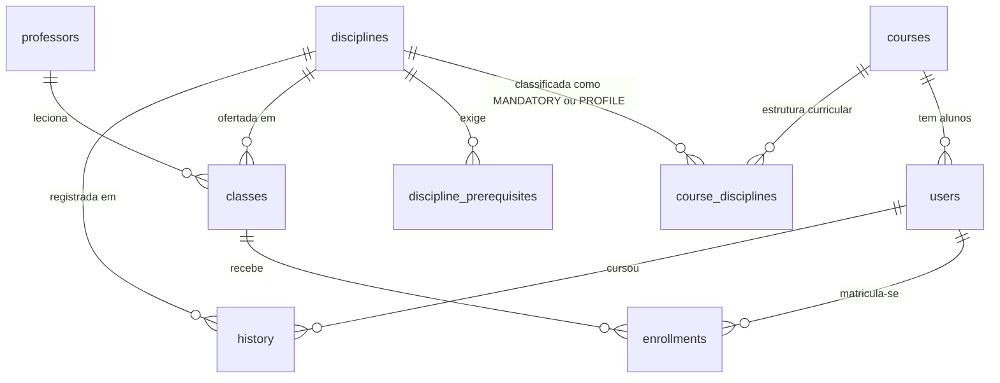
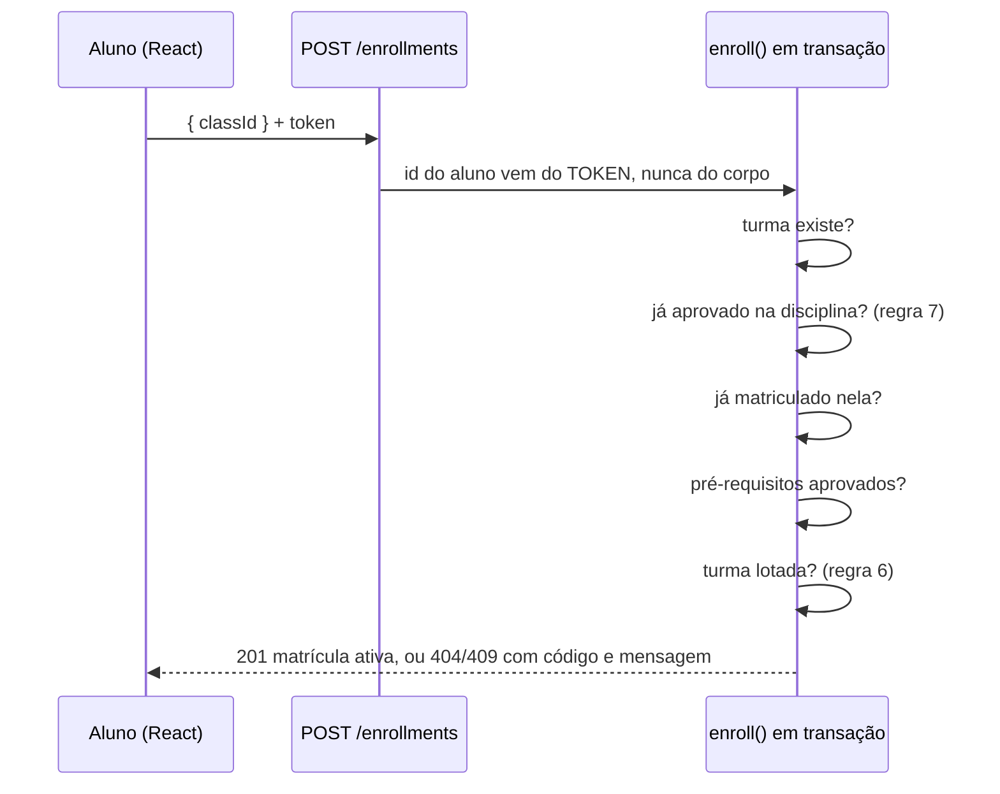

<div align="center">

# Sistema de Matrícula

**Matrícula de graduação com perfis de Secretaria e Aluno, regras de negócio testadas e requisito extra de pré-requisitos.**


Teste prático · Bolsa de Inovação Tecnológica em Engenharia de Software · CIn-UFPE (Edital nº 5/2026)

[Visão geral](#visão-geral) · [Início rápido](#início-rápido) · [Arquitetura](#arquitetura) · [Regras de negócio](#regras-de-negócio) · [API](#referência-da-api) · [Decisões](#decisões-de-projeto)

</div>

---

## Sumário

- [Visão geral](#visão-geral)
- [Funcionalidades](#funcionalidades)
- [Início rápido](#início-rápido)
- [Usuários de demonstração](#usuários-de-demonstração)
- [Arquitetura](#arquitetura)
- [Regras de negócio](#regras-de-negócio)
- [Requisito extra: pré-requisitos](#requisito-extra-pré-requisitos)
- [Referência da API](#referência-da-api)
- [Testes](#testes)
- [Decisões de projeto](#decisões-de-projeto)
- [Limitações e próximos passos](#limitações-e-próximos-passos)
- [Fluxo de desenvolvimento](#fluxo-de-desenvolvimento)

## Visão geral

O sistema permite que a **Secretaria de Graduação** cadastre disciplinas e professores e abra turmas com um número de vagas, e que o **Aluno** se matricule nas turmas do semestre corrente e acompanhe quanto falta para concluir o curso.

Cada curso tem uma estrutura curricular que classifica as disciplinas como **obrigatórias** ou **eletivas de perfil**; o que não consta na estrutura do curso do aluno conta como **eletiva livre**. A mesma disciplina pode ter classificações diferentes em cursos diferentes.

| Componente | Tecnologias |
|---|---|
| `backend/` | Node 22, Express, TypeScript, SQLite (`better-sqlite3`), zod, JWT |
| `frontend/` | React 18, Vite, TypeScript, React Router, CSS próprio |
| Testes | Vitest, Supertest (API), Testing Library (interface) |

## Funcionalidades

| Perfil | O que faz |
|---|---|
| **Secretaria** (desktop) | Disciplinas: listagem com busca e paginação, cadastro e edição · Professores: listagem e cadastro · Turmas: vagas ocupadas/totais, abertura de turma e alteração de vagas |
| **Aluno** (mobile, a partir de 360 px) | Ofertas do semestre com vagas disponíveis e classificação (obrigatória, perfil ou livre) · Matrícula e cancelamento · Progresso por grupo: CH exigida, integralizada, em curso e restante |
| **Comum** | Login por nome de usuário, área separada por perfil, sessão expirada volta ao login |
| **Interface** | Busca e página refletidas na URL · estados de carregamento, lista vazia, busca sem resultado e erro com "Tentar de novo" · mensagens claras quando uma regra de negócio recusa a ação |

## Início rápido

**Requisitos:** Node 22 e npm. (A versão 22 foi a testada; `better-sqlite3` precisa de binário pré-compilado ou de ferramentas de compilação.)

```bash
# 1. Back-end  ->  http://localhost:3333
cd backend
npm install
npm run seed      # cria matricula.db com os dados iniciais
npm start

# 2. Front-end  ->  http://localhost:5173   (outro terminal)
cd frontend
npm install
npm run dev       # o Vite encaminha /api para http://localhost:3333
```

> [!WARNING]
> `npm run seed` **apaga e recria** o arquivo do banco. Já `npm start` só popula o banco se ele ainda não existir.

**Variáveis de ambiente (opcionais)**

| Variável | Onde | Padrão | Uso |
|---|---|---|---|
| `PORT` | backend | `3333` | Porta da API |
| `DB_FILE` | backend | `matricula.db` | Arquivo do SQLite |
| `JWT_SECRET` | backend | segredo de desenvolvimento | **Defina um valor forte fora do ambiente local** |
| `VITE_API_URL` | frontend | `/api` | Endereço da API, se não usar o proxy do Vite |

## Usuários de demonstração

O login é apenas com o nome de usuário (a senha é opcional no enunciado).

| Usuário | Perfil | Curso | O que demonstra |
|---|---|---|---|
| `secretaria` | Secretaria | — | Telas de cadastro e turmas |
| `ana` | Aluno | Sistemas de Informação | 180 h de perfil aprovadas (excede 120 h; o excedente vira livre) · reprovada em IF673 |
| `bia` | Aluno | Sistemas de Informação | Só aprovada em IF668: não pode cursar IF700 (falta IF669) |
| `carlos` | Aluno | Ciência da Computação | Reprovado em IF669: reprovação não satisfaz o pré-requisito de IF703 |
| `dani` | Aluno | Ciência da Computação | Só aprovada em IF668 |

IF702 é eletiva de perfil em SI e obrigatória em CC; IF673 é o inverso. A turma de IF673 tem apenas 2 vagas, o que facilita testar turma lotada.

## Arquitetura

```text
.
├── backend/
│   ├── src/
│   │   ├── app.ts            # rotas: validam a entrada (zod) e delegam aos serviços
│   │   ├── auth.ts           # login, JWT e guardas de sessão e perfil
│   │   ├── db.ts             # esquema SQLite
│   │   ├── seed.ts           # dados iniciais
│   │   ├── errors.ts         # AppError (status + código + mensagem)
│   │   └── services/         # regras de negócio, uma por assunto
│   └── tests/                # um arquivo por assunto
└── frontend/
    ├── src/
    │   ├── pages/            # student/ e secretary/
    │   ├── components/       # AsyncView, PagedView, Pagination, SearchBox, Notice, layouts
    │   ├── hooks/            # useResource, usePagedSearch
    │   ├── contexts/         # AuthContext
    │   ├── services/         # api.ts (fetch + sessão) e um arquivo por recurso
    │   └── routes/           # AppRoutes e RequireRole
    └── tests/
```

**Fluxo de uma requisição:** `rota (app.ts)` → valida com zod → `serviço` aplica a regra e acessa o banco → erro de regra vira `AppError` → um único middleware formata a resposta `{ error: { code, message, details? } }`.

### Modelo de dados



- `enrollments` guarda só o **semestre corrente** (`ACTIVE` ou `CANCELLED`); `history` guarda os semestres anteriores (`APPROVED` ou `FAILED`).
- A classificação (`course_disciplines`) pertence à relação curso × disciplina, por isso uma disciplina pode ser obrigatória em um curso e eletiva em outro. Ausente da relação = eletiva livre.

### Fluxo de matrícula



## Regras de negócio

| # | Regra | Onde é garantida |
|---|---|---|
| 1 | Código de disciplina único | `services/disciplines.ts` + `UNIQUE` no banco |
| 2 | CH múltipla de 15, entre 15 h e 120 h | schema zod + `CHECK` no banco + seletor da interface |
| 3 | E-mail de professor único | `services/professors.ts` + `UNIQUE` no banco |
| 4 | Turma com disciplina, professor e ≥ 1 vaga | `services/classes.ts` + `CHECK` no banco |
| 5 | Vagas nunca abaixo do número de matriculados | `updateCapacity` em transação |
| 6 | Sem matrícula em turma lotada | `enroll` em transação |
| 7 | Sem matrícula em disciplina já aprovada; reprovada pode repetir | `enroll` consulta o histórico |
| 8 | Cancelar devolve a vaga | `cancel` só muda o status; a ocupação conta apenas `ACTIVE` |
| 9 | Aluno só vê e altera as próprias matrículas | id vem do token; matrícula alheia responde 404 |
| 10 | Classificação depende do curso do aluno | `services/classification.ts` |
| 11 | Excedente de perfil conta como livre | `services/progress.ts` (vale para o aprovado **e** para o em curso) |
| 12 | Só aprovação integraliza; matrículas ativas aparecem como "em curso" | `services/progress.ts` |
| 13 | Percentual ≤ 100 % e CH restante nunca negativa | `group()` em `services/progress.ts` |

## Requisito extra: pré-requisitos

**Por que:** é uma regra comum em sistemas de matrícula e reaproveita dados que o modelo já tem (o histórico), atravessando back-end e front-end sem alterar o resto do modelo.

1. Uma disciplina pode ter vários pré-requisitos, definidos pela secretaria ao cadastrar ou editar (o `PUT` substitui a lista inteira).
2. O aluno só se matricula com **aprovação** em todos eles. Reprovação e matrícula ativa **não** satisfazem.
3. A recusa é `409 PREREQUISITE_NOT_MET`, com os códigos pendentes em `error.details.missing`.
4. Valem para todos os cursos.
5. Recusados: pré-requisito inexistente (`404`), a própria disciplina (`400`) e ciclos (`409 PREREQUISITE_CYCLE`, detectados por busca em profundidade).
6. As ofertas mostram os pré-requisitos e o que falta; o botão de matrícula fica bloqueado.

## Referência da API

Autenticação: `POST /auth/login` devolve um JWT de 8 h; enviar `Authorization: Bearer <token>`. Erros: `{ "error": { "code", "message", "details?" } }`.

| Método | Rota | Perfil | Descrição |
|---|---|---|---|
| `POST` | `/auth/login` | — | `{ username }` → `{ token, user }` |
| `GET` | `/disciplines` | Secretaria | `?search&page&pageSize`; inclui `prerequisites` |
| `POST` | `/disciplines` | Secretaria | `code`, `name`, `workload`, `prerequisiteIds?` |
| `PUT` | `/disciplines/:id` | Secretaria | Edita e substitui os pré-requisitos |
| `GET` | `/professors` | Secretaria | Lista com busca e paginação |
| `POST` | `/professors` | Secretaria | `name`, `email` |
| `GET` | `/classes` | Secretaria | Turmas com `occupied` e `capacity`, paginado |
| `POST` | `/classes` | Secretaria | `disciplineId`, `professorId`, `capacity` |
| `PATCH` | `/classes/:id` | Secretaria | `{ capacity }` |
| `GET` | `/offers` | Aluno | `availableSeats`, `kind`, `prerequisites`, `missingPrerequisites` |
| `GET` | `/enrollments` | Aluno | Minhas matrículas ativas |
| `POST` | `/enrollments` | Aluno | `{ classId }` |
| `DELETE` | `/enrollments/:id` | Aluno | Cancela; a vaga volta para a turma |
| `GET` | `/progress` | Aluno | Por grupo: exigida, integralizada, em curso, restante e percentual |

**Status:** `400` validação · `401` sessão ausente ou expirada · `403` perfil sem acesso · `404` não encontrado · `409` regra de negócio recusada.
**Códigos de `409`:** `CLASS_FULL`, `ALREADY_APPROVED`, `ALREADY_ENROLLED`, `ENROLLMENT_NOT_ACTIVE`, `CAPACITY_BELOW_ENROLLED`, `DISCIPLINE_CODE_TAKEN`, `PROFESSOR_EMAIL_TAKEN`, `PREREQUISITE_NOT_MET`, `PREREQUISITE_CYCLE`.

## Testes

```bash
cd backend  && npm test && npm run typecheck
cd frontend && npm test && npm run typecheck && npm run build
```

- **Back-end (46 testes):** cada regra de negócio tem testes de API contra um SQLite em memória com o mesmo seed, incluindo os cenários de borda (turma lotada, aprovado × reprovado, excedente de perfil, ciclo de pré-requisitos, rollback de edição recusada).
- **Front-end (53 testes):** login e guarda de perfis, sessão expirada, cada tela com seus estados (carregando, vazio, erro com nova tentativa), busca e página na URL, e as mensagens de recusa por regra.

## Decisões de projeto

**Back-end**
- **SQLite:** nada para instalar; as transações síncronas do `better-sqlite3` tornam simples garantir a regra de vagas.
- **Rotas finas, regras em serviços:** `app.ts` só valida e delega; cada serviço cabe em uma explicação.
- **Segurança:** o aluno é identificado pelo token, nunca por um id enviado pelo cliente; SQL sempre parametrizado; busca remove os coringas do `LIKE`.
- **Sem ORM:** o SQL é pequeno e explícito.

**Front-end**
- **Sem biblioteca de estado de servidor:** o hook `useResource` cobre carregamento, erro com nova tentativa e descarte de respostas atrasadas.
- **Busca e página na URL** (`usePagedSearch`): recarregar e voltar preservam o estado.
- **Sessão expirada:** qualquer `401` autenticado limpa a sessão e volta ao login com aviso; `RequireRole` impede um perfil de abrir a área do outro.
- **Proxy do Vite** para `/api`: sem CORS e sem URL fixa no código.

## Limitações e próximos passos

Escolhas deliberadas do escopo do teste:
- Login sem senha (permitido pelo enunciado). Em produção: senha com hash, `JWT_SECRET` obrigatório, limite de tentativas, CORS restrito, `helmet` e HTTPS.
- O esquema usa `CREATE TABLE IF NOT EXISTS`: não há migrações versionadas. Mudanças de estrutura exigem recriar o banco com `npm run seed`.
- Os seletores de turma e de pré-requisitos carregam até 100 itens (limite da API); com catálogos maiores, usar busca assíncrona.
- Professores só têm listagem e cadastro; a listagem de turmas não tem busca.
- Consultas por item em ofertas e progresso (N+1) foram mantidas por simplicidade, dado o volume pequeno.

Com mais tempo: integridade extra no esquema (curso obrigatório para aluno, CH exigida não negativa), testes de ponta a ponta (Playwright), CI no GitLab (typecheck, testes e build), PostgreSQL com bloqueio de linha para concorrência real, lista de espera e choque de horário.

## Fluxo de desenvolvimento

Cada funcionalidade nasceu em uma branch (`feat/…`, `fix/…`, `refactor/…`, `chore/…`, `docs/…`), mergeada na `develop` com `--no-ff`; ao final, a `develop` foi mergeada na `main`. Commits em português, no padrão Conventional Commits.
